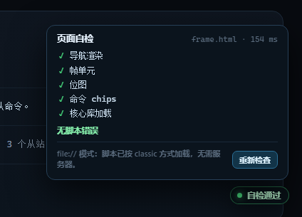

# EtherCAT 可视化学习站

把 EtherCAT 协议栈拆成可以点的图：**一帧怎么组成、怎么穿过从站、状态机怎么走、邮箱怎么说话、时间怎么同步**。
每个图元都标注了它来自 `etg_doc/` 下哪本 ETG 规范的哪一节。

- 纯静态：HTML + 原生 JS，无后端、无外部 CDN。
- **离线可用**：直接双击 `index.html` 即可。脚本打包成 classic script，
  不走 ES module import——浏览器会以 CORS 拦掉 `file://` 下的模块加载，导致所有按钮失效。
- 数据层/UI 层是 ES module 源文件，构建时合并为 `assets/js/ec-core.js`（生成物）。
- 中英术语对齐 ETG 新命名：**MainDevice**（主站）/ **SubDevice**（从站）。

---

## 快速开始

**方式一：直接打开（file://）**

双击 `index.html`。所有交互页面、学习手册、规范索引都能用；
只有“在新标签页打开 PDF”这一步取决于浏览器是否内置 PDF 预览。

> 早期版本用 ES module 加载 `assets/js/data.js`，Chrome 在 `file://` 下会以
> “origin 'null' 的 CORS 限制”拒绝加载，表现为页面能显示但**所有按钮点不动**。
> 现在页面统一加载 classic 脚本 `assets/js/ec-core.js`，file:// 与 http:// 行为一致。

**方式二：本地静态服务器（推荐，行为与线上一致）**

```powershell
# Windows PowerShell
.\start.ps1
# 或
node .tools/serve.mjs 4173
```

然后访问 <http://127.0.0.1:4173/index.html>。

---

## 页面地图

| # | 页面 | 你会看到什么 |
|---|---|---|
| 00 | `index.html` | 三层协议栈（可点，联动规范）、学习顺序、本地资料清单 |
| 01 | `frame.html` | 整帧逐字节/逐位拆解；点任意位可翻转并实时重算；15 条命令码；WKC 怎么累加；PDU 构造器 |
| 02 | `network.html` | 发一帧穿过 5 个从站：APRD/FPRD/BRD/LRW 四种场景、FMMU 覆盖图、时延预算计算器 |
| 03 | `master.html` | ETG.1500 的 27 项 Class A/B 能力矩阵、11 步启动时序、周期时间线、主站诊断对象 0x8nnn/0x9nnn/0xAnnn |
| 04 | `al.html` | ESM 五态状态机（可点击迁移、AL Control/Status 位图、错误场景）、邮箱头 + CoE 头、SDO 快速/分段/CA/Emergency 报文 |
| 05 | `eoe-foe-soe.html` | EoE / FoE / SoE 逐字节拆解：EoE 4 字节头与 32 字节分片、FoE 六个 OpCode 与固件下载时序、SoE 的 IDN 模型；四协议对比 |
| 06 | `slave.html` | 真实 ESI 示例（3 个官方 XML）解析成可点的树；SII/EEPROM 字表；从站实现路线；CTT 测试章节 |
| 07 | `dc.html` | 分布式时钟：晶振漂移、ARMW 补偿、SYNC0 时序；DC 寄存器速查；四个常见坑 |
| 08 | `spec.html` | 17 份本地文档索引：版本、访问级别、路径、关键章节、被哪个模块使用；条款→页面对照；覆盖矩阵 |
| 09 | `guide.html` | 《EtherCAT 学习手册》通读版（由 `docs/guide.md` 编译） |

---

## 页面自检徽标

每个页面右下角有一个小徽标，用来区分“页面没渲染出来”和“脚本没跑起来”：

| 状态 | 含义 |
|---|---|
| 🟢 自检通过 | 脚本已执行，且该页关键内容（导航、帧单元、ESI 树、矩阵…）都已渲染 |
| 🟡 自检异常 N | 脚本执行了，但有 N 项内容没渲染出来（点开看具体哪项） |
| 🟡 脚本未执行 | 脚本完全没跑（`file://` 下模块被 CORS 拦截、`ec-core.js` 404、JS 报错等） |
| ⚪ 检查中… | 脚本已加载，正在等 `load` 后做检查 |

徽标是**静态 HTML** 的一部分，脚本没跑起来时它会停在“脚本未执行”，
不会凭空消失——这正是它比控制台更直观的地方。点击徽标展开明细：
检查项、耗时、当前协议（`file:` / `http:`）、捕获到的脚本错误，以及“重新检查”。



每个页面的检查项定义在 `assets/js/ui.js` 的 `PAGE_CHECKS` 里，加页面时补一条即可。

```powershell
# 徽标专项：正常页应为 ok；去掉脚本的页面应停在“脚本未执行”
node .tools/check_selfcheck.mjs
```

---

## 目录结构

```
LearnEtherCAT/
├── index.html / frame.html / network.html / master.html
├── al.html / eoe-foe-soe.html / slave.html / dc.html / spec.html / guide.html
├── assets/
│   ├── css/style.css               # 全站样式（暗色工业风）
│   ├── js/data.js                  # 规范索引、命令码、ESM、寄存器、能力矩阵…（源文件）
│   ├── js/ui.js                    # 导航壳、提示气泡、小工具（源文件）
│   ├── js/ec-core.js               # 上面两者合并出的 classic 包（生成物，页面实际加载）
│   └── data/esi-examples.json      # 由真实 ESI XML 生成的精简树
├── docs/guide.md                   # 学习手册源文件
├── etg_doc/                        # 你提供的官方 ETG 文档（不随仓库分发）
├── start.ps1                       # 一键启动本地服务器
└── .tools/                         # 构建与测试脚本（不参与网页运行）
    ├── serve.mjs                   # 静态服务器
    ├── gen_esi.mjs                 # ESI XML → JSON
    ├── gen_mbx.py                  # 生成 EoE/FoE/SoE 报文页
    ├── build_core.py               # data.js + ui.js → ec-core.js，并把页面改成 classic
    ├── embed_esi.py                # 把 JSON 内联进 slave.html
    ├── build_guide.py              # guide.md → guide.html
    ├── check_syntax.py             # 抽取页面内 module 脚本做语法检查
    ├── domtest.mjs                 # jsdom 加载页面，捕获运行时错误
    ├── verify_all.mjs              # 真实 Chrome 全站回归（file:// 与 http://）
    ├── check_selfcheck.mjs         # 自检徽标正/负用例
    ├── check_frame_interactions.mjs# frame.html 交互专项
    └── check_file_proto.mjs        # 单独验证 file:// 下脚本是否执行
```

---

## 数据与构建

内容改动集中在两处：

- **文字/结论** → `assets/js/data.js`（规范索引、寄存器、命令码、能力矩阵）
- **长文** → `docs/guide.md`，改完执行：

```powershell
python .tools/build_core.py        # 改了 data.js / ui.js 后必须执行：重建 ec-core.js
python .tools/build_guide.py       # 生成 guide.html
python .tools/embed_esi.py         # 改了 ESI 数据后重新内联
node  .tools/gen_esi.mjs           # 从 etg_doc 的 ESI XML 重新生成 JSON
```

> `assets/js/ec-core.js` 是生成物，不要手改；只改 `data.js` / `ui.js` 后跑一次 `build_core.py`。

> `.tools` 里的依赖（jsdom、fast-xml-parser）只在开发测试时用，网页本身零依赖。

---

## 自测

测试脚本依赖 `.tools/` 下的两个开发期依赖（jsdom、fast-xml-parser），首次使用先安装：

```powershell
cd .tools
npm install jsdom fast-xml-parser
cd ..
```

```powershell
# 每个页面内联脚本的语法
python .tools/check_syntax.py index.html

# jsdom 运行时检查（导航、单元格、位图、SVG、表格行数）
node .tools/domtest.mjs frame.html

# 真实 Chrome 全站回归：file:// 与 http:// 各跑一遍，含代表性点击
node .tools/verify_all.mjs file
node .tools/verify_all.mjs http

# frame.html 专项：场景按钮 / 命令 chips / LEN、IRQ 滑块 / 帧单元点击
node .tools/check_frame_interactions.mjs

# 自检徽标：正常页 ok + 无脚本页保持“脚本未执行”
node .tools/check_selfcheck.mjs
```

当前 10 个页面在 jsdom 与 Chrome 下均为 0 runtime error；`frame.html` 渲染 13 个帧单元 + 96 个位；
`slave.html` 渲染 697 个 ESI 节点；`spec.html` 渲染 73 行；`guide.html` 渲染 102 行表格。

---

## 版权与边界

- `etg_doc/` 下的 PDF 版权归 **EtherCAT Technology Group (ETG)** 所有。
  本仓库只做本地索引与学习摘要，**不复制原文、不重新分发规范**。
- 标“会员”的文档需要 ETG 会员账号；标“免费”的可在 ETG 下载页公开获取。
- 对外分享时请只分享代码与链接，不要打包 `etg_doc/`。
- 实现以 ETG 官方英文最新版为准；旧版（如 ETG.1000 V1.0.2 中文版）在 DC、AL Status Code、
  ESI 上有差异。

## 参考入口

- ETG 下载总入口：<https://www.ethercat.org/en/downloads.html>
- ETG.1000 系列：<https://www.ethercat.org/en/downloads/downloads_A02E436C7A97479F9261FDFA8A6D71E5.htm>
- ETG.2200 从站实现指南（免费）：<https://www.ethercat.org/cn/downloads/downloads_7BA2567EB9F443219AD0014448F674F2.htm>
- ETG.1500 主站等级（免费）：<https://www.ethercat.org/en/downloads/downloads_E8DE229AAF2C452D937F02791437F4B4.htm>
